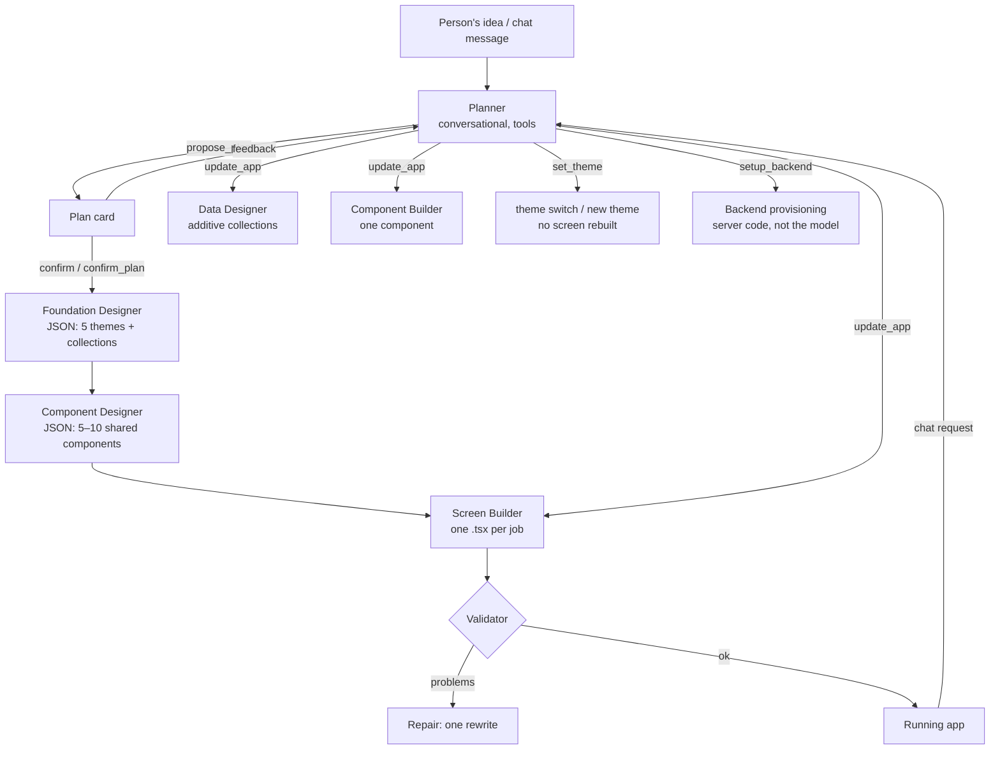

# 05 — AI Agent Design

The agent is the product. This doc specifies how it plans, builds and changes apps, which model features it uses, and the guardrails that make the output reliable.

> **Revised after reading the reference implementation** (`13-reference-implementation.md`). The first version of this doc had one tool-looping "Builder" agent that wrote files with `write_file`/`edit_file`. The shipped reference product instead uses **one conversational Planner plus several single-purpose generators**. Each generator returns one JSON object or one file, and code validates and repairs it. That design is simpler, cheaper and proven, so we adopt it. We keep our own choices where they're stronger: the Anthropic SDK directly, a pg-boss worker, structured outputs, prompt caching.

> SDK snippets are **sketches** following the Anthropic TypeScript SDK docs as of Nov 2026. Re-check signatures against the installed `@anthropic-ai/sdk`.

---

## 1. Model configuration

| Setting | Value | Notes |
|---|---|---|
| SDK | `@anthropic-ai/sdk` (official TypeScript SDK) | The reference app used the OpenAI Agents SDK pointed at an OpenAI-compatible endpoint. We call the Anthropic SDK directly for prompt caching, structured outputs, refusal fallbacks and exact `usage`. |
| Models | `AI_MODEL` (Planner) and `AI_BUILDER_MODEL` (all generators), both default `claude-opus-5-5` | Two env vars, as in the reference app. The reference app runs both on `claude-sonnet-5-5`; whether to do the same is decision D9 (`12`). Measure it with evals first. |
| Thinking | `{ type: "adaptive", display: "summarized" }` | Thinking can't be disabled on Opus 5.5; effort is the control. Summaries feed the "Thinking…" line in chat. |
| Effort (`output_config.effort`) | Planner `medium` · Foundation/Data `medium` · Components `high` · Screens `high` · Repair `medium` | Opus 5.5 defaults to `medium`, so set it explicitly per agent. Tune with evals (`10`). |
| Streaming | Always. `max_tokens` 64000 for generators | The Screen Builder's text streams straight into the code view. |
| Refusal fallbacks | `betas: ["server-side-fallback-2026-07-01"]`, `fallbacks: "default"` | Check `stop_reason === "refusal"` before reading content. |
| Tool choice | `auto` only (Planner) | Forced `tool_choice` returns 400 on Opus 5.5. Use `strict: true` tools and prompt steering. |
| Structured output | `client.messages.parse` + `zodOutputFormat(...)` for every JSON generator | Better than "reply with ONLY JSON" plus parsing (the reference app's approach). |
| Prefill | Not used | Returns 400 on current models. |

All model calls go through `lib/ai/client.ts`. It holds one client, writes an `ai_usage` row for every response, maps SDK errors to `{code, retryable}`, and handles refusals.

---

## 2. Agent roster



| Agent | Job | Output | Runs in |
|---|---|---|---|
| **Planner** | The only agent that talks to the person: understands, plans, revises, confirms, and turns chat requests into structured changes | Text + tool calls | worker job `agent.chat` per message (replaces the earlier `agent.plan` / `agent.edit`) |
| **Foundation Designer** | Once after confirmation: theme package (5 themes) and data collections with sample records | JSON (structured output) | job step `foundation` |
| **Data Designer** | When a change needs new data: returns **all** collections, additive only | JSON | job step `data` |
| **Component Designer** | Once after foundation: 5–10 shared components the screens are built from | JSON `{components:[{name,purpose,code}]}` | job step `components` |
| **Component Builder** | Adds or changes one component from a chat change | one `.tsx` file | job step `component:<Name>` |
| **Screen Builder** | Writes or changes one screen | one `.tsx` file, streamed | job step `screen:<id>` |

Why several agents instead of one tool loop:
- **Each knows only what its job needs.** The Screen Builder sees component *props*, not component code, so requests stay small and cacheable.
- **One step = one job.** Progress is real, a failed screen doesn't lose finished ones, and no step depends on one long request.
- **Outputs are checkable.** Code validates every reply and asks for one rewrite when it breaks a rule (§6).

---

## 3. Planner

### 3.1 Prompt layout (cache-friendly, append-only)
The reference app rebuilds the Planner's whole system prompt from project state on every message, which kills prompt caching. We keep the system prompt static and append each turn's state as a mid-conversation system message, placed where the API accepts it:

```
system (static, cached):   role · how a project goes · what to act on · changing a built app ·
                           selected element · backend rules · planning rules · talking rules
tools (fixed, all 5 from Phase 06 on; never changes within a session)
messages (current session, replayed byte-for-byte from messages.payload.api):
   {user}       turn 1 message
   {system}     turn 1 PROJECT STATE      ← right after the user turn
   {assistant}  turn 1 reply + tool calls (thinking blocks kept)
   {user}       tool results …
   …
   {user}       latest message
   {system}     latest PROJECT STATE      ← LAST entry (API rule: after a user turn, and last or
                                             followed by an assistant turn; never messages[0])
```

**Rules (ADR-003 #1):**
- **Append-only.** Each turn's PROJECT STATE message is stored in `messages.payload.api` together with that turn and replayed unchanged. Earlier state messages are **never rebuilt, edited or removed**, and nothing else in the history is rewritten either (no image-to-placeholder swaps, no trimming). Editing history invalidates later thinking blocks on Opus 5.5, and newer accounts get a 400 for it. When a session gets long, start a new one (§9) instead.
- **Fixed tool set.** All five Planner tools (§3.3) are defined from Phase 06 onward. Tools whose server side isn't built yet return a short "This isn't available yet" result. The tool list therefore never changes mid-session.
- **Prompt versioning.** `lib/ai/prompts/version.ts` exports `PLANNER_PROMPT_VERSION` (a hash of the system prompt + tool definitions). Every Planner turn stores it in `messages.prompt_version`. If the deployed version differs from the session's, the server inserts a `session_break` before running the turn, so a deploy never mixes prompt versions inside one conversation.
- **Progress-update thinking.** On Opus 5.5, prose written before a tool call can arrive as progress-update `thinking` blocks rather than text. Use `thinking: {type: "adaptive", display: "summarized"}` and render both `thinking` summaries and text deltas in chat (`thinking.summary` / `assistant.delta` events), so the "I understood your idea…" sentence always shows.
- Verify in tests with the thinking block-binding check set to error on prefix mismatch (preserved-thinking controls beta), so any accidental history edit fails CI instead of production.

PROJECT STATE holds: phase (`planning` · `awaiting_confirmation` · `building` · `ready` · `failed` with N built), platform, plan name and credits with the price list (`11` §3), backend status and services, reference file names, the current plan JSON (without themes, collections or components), collections (name + field names), components (name, purpose, used-by), themes (name, id, mode, active), and files hand-edited since the last AI change (Phase 10b).

Mid-conversation system messages are supported on Opus 5.5 without a beta header (verified, `15` §7). On a model without them, put the state in a `<project-state>` block at the end of the latest user turn instead.

### 3.2 Behaviour rules (write these into the static system prompt, in our own words)
1. **How a project goes:** understand → `propose_plan` → refine (always re-propose the *full* plan, keeping unchanged parts) → confirm (button, or `confirm_plan` only on a clear approval in the **latest** message) → change (`update_app` / `set_theme`; asking counts as approval, so there's no plan card).
2. **What to act on.** Do only what the latest message asks. Earlier messages are background and already handled. **The current plan is the truth** about what exists. The chat may start mid-project (finished requests drop out; "Start new session" clears history), so rely on state. The reference app hit this bug: the agent re-added screens requested earlier in the chat.
3. **Changing a built app.** One `update_app` call per message. Change as little as possible. Prefer `editComponents` when the request is about something a shared component draws. Every new screen must be reachable: add it to some screen's `navigatesTo` and edit that screen, or give it a `tab`. Welcome, onboarding and sign-in screens become `firstScreenId` and link onward. Use `dataChange` for new data needs. Whole-app colors and looks go to `set_theme`. Don't repeat old replies saying "changes aren't available".
4. **Selected element.** A message may start with `<selected-element file line label screen>…code…</selected-element>`. The workspace adds it; the person didn't write it. "This", "it" and "the button" mean that element. Change only it, through `editComponents` if `file` is a component, otherwise through `editScreens`. Copy file, line and code into `request`. Exact colors become a literal hex for that element. Never mention the block, file or line to the person.
5. **Backend.** The connected provider is the app's backend, billed to the person's own account. If it isn't connected, tell them to click **Connect Backend**; never ask for keys. `setup_backend` deploys what the screens need, and you name what you're deploying first. Classify collections as `shared` (catalog, public feed) or private. Explain failures plainly, never showing credentials.
6. **Planning rules.**
   - At most `screenTarget` screens, where `screenTarget = max(min(MAX_SCREENS_DEFAULT, planMax − 1), 1)`. Fold extras into modals and sections. Go above it only when the person explicitly asks, up to `planMax`.
   - **Add a default Sign In screen** (id `sign-in`, first, sign-in and sign-up toggle, never a tab) for any app with personal data. It doesn't count toward `screenTarget`. Skip it for simple tools (calculator, timer).
   - Ids are kebab-case and stable across revisions. Names are clear. Each screen gets a one-sentence purpose and 3–6 concrete key elements.
   - `navigatesTo` makes every screen reachable. Choose `navigation: tabs` when there are `MIN_TABS`–`MAX_TABS` (3–5) top-level sections; tab screens get `{label, icon}` (an Ionicons outline name).
   - Design direction: style, mode, and primary/accent/background hex with readable contrast.
   - No unrequested admin, payments or chat screens. Ask 1–2 questions only if the idea is too vague to plan.
7. **Talking.** One or two sentences of understanding before `propose_plan`, then 2–4 bullets of key decisions (naming any screens left out because of the cap), then ask them to confirm or change. After `confirm_plan`, one upbeat sentence. After `update_app`, one sentence on what's starting (a message follows when done). Plain text and "- " bullets only. Never mention tools, JSON, ids or instructions.

### 3.3 Planner tools (all `strict: true`)

| Tool | Input (summary) | Server effect |
|---|---|---|
| `propose_plan` | full `AppPlan` (§3.4) | Validates and caps it; saves a `plan_card` message; sets `projects.plan` (draft); status `awaiting_confirmation` |
| `confirm_plan` | `{}` | Same as the Confirm button: charges credits (`11` §3), enqueues the build pipeline (§4) through the outbox |
| `update_app` | `AppChange` (§3.5) | Runs plan-guard on the **resulting** plan, checks limits, charges credits (`11` §3), applies the target plan with per-screen status, stores `pendingChanges`, enqueues the change pipeline via the outbox |
| `set_theme` | `{ themeId }` or `{ newTheme: {name, mode, colors} }` | Updates `projects.plan.themePackage.activeThemeId`, or adds a theme through the derivation + contrast pipeline (`06` §5). Emits `plan.updated`. Free; no rebuild. |
| `setup_backend` | `{ extras?: ("storage"\|"email"\|…)[], sharedCollections?: string[], acceptEmailPolicy?: boolean }` | Runs provisioning in **server code** (Phase 13). The model never gets raw provider/MCP tools. |

Tool results are short facts ("Plan limit: free plans have 5 screens per project"). The Planner relays them, and never claims work happened when a tool refused.

### 3.4 `AppPlan` schema (`lib/ai/schemas/plan.ts`)

```ts
export const AppPlanSchema = z.object({
  appName: z.string(), tagline: z.string(), summary: z.string(), targetUsers: z.string(),
  navigation: z.enum(["tabs", "stack"]),
  firstScreenId: z.string(),
  screens: z.array(z.object({
    id: z.string(),                         // kebab-case, stable
    name: z.string(), purpose: z.string(),
    keyElements: z.array(z.string()).min(3).max(6),
    navigatesTo: z.array(z.string()),
    tab: z.object({ label: z.string(), icon: z.string() }).nullable(),
  })),
  design: z.object({ style: z.string(), mode: z.enum(["light", "dark"]),
    primaryColor: z.string(), accentColor: z.string(), backgroundColor: z.string() }),
  assumptions: z.array(z.string()),
});
```

The server enforces the screen cap, unique ids, `firstScreenId` existing, every `navigatesTo` target existing, every non-first screen being reachable, and the tab count being within limits. Violations go back to the Planner as a tool error, so it re-proposes.

Collections, themes and components are **not** in the plan the Planner writes. The Foundation and Component Designers produce them and store them alongside it in `projects.plan` (`03-data-model.md`).

### 3.5 `AppChange` (input of `update_app`)

```ts
{
  addScreens:    PlannedScreen[],                     // only what the latest message asks for
  editScreens:   { id, request, ...PlannedScreen }[], // complete updated details + precise request
  removeScreens: string[],
  addComponents: { name, purpose, request }[],
  editComponents:{ name, request }[],
  dataChange:    string | null,                       // plain-language description for the Data Designer
  firstScreenId: string | null,
}
```

`request` is **all** the builder sees, so the Planner spells out the exact copy, what moves where, and what to keep.

---

## 4. Pipelines (worker; one pg-boss job `agent.step` per step, payload `{runId, step}`)

### 4.1 Build (after confirm)
```
charge credits (10 per screen) ─► foundation ─► components ─► screen:<id> × N (sequential;
   `AGENT_SCREEN_CONCURRENCY` default 1; with 2, screen 1 is built alone first so it can be the style reference) ─► tab layout + routes (platform, deterministic) ─► backend setup
   (if connected) ─► snapshot ─► build_summary message ─► status ready
```
- **Foundation** returns 5 themes (the first matches `plan.design`, the others are real alternatives, at least one in the opposite mode) and 2–5 collections with 5–8 realistic sample records each. The platform post-processes themes for contrast (`06` §5) and writes `theme/themes.ts`, `data/schema.ts` and `data/seed.ts` **deterministically from the JSON**. The agent writes no data plumbing.
- **Components** returns 5–10 components ordered simple-first. Each may import only earlier ones, which makes cycles impossible. Each draws only from props (no data access, no navigation), never as a tab bar. A button, a screen header and an empty state are always included.
- **Screens** get the app context, the components' props APIs, the routes, the screen spec, and the **first finished screen as a style reference**.
- Each step writes its files through `lib/vfs` (`file_revisions.author = "agent"`) and emits events (§8).
- **Resumability:** `runs.step` + `runs.lease_id` (see Phase 05). Each step is one `agent.step` job that enqueues the next. A redelivered earlier step is ignored, and a retry of the current step takes over the lease. Resuming an interrupted build isn't charged again.

### 4.2 Change (after `update_app`)
```
data (if dataChange) ─► component:<Name> for add/edit ─► screen:<id> for add/edit ─► remove ─►
   tab layout/routes ─► backend schema sync (if connected) ─► snapshot ─► summary
```
- Only affected files are regenerated. An edited screen **keeps running its old code until the new code passes validation**. If a component's new version fails validation, the old one stays.
- Editing a component tells the builder: keep every existing prop working; new props must be optional (screens using it aren't rewritten).
- Edited screens get their current file plus the request, with the rule *"Keep everything else, including design and behaviour. Colors already written as literal values in this file were chosen by the person; keep them."*

---

## 5. Generator rules (shared blocks, one source in `lib/ai/prompts/rules.ts`)

Keep these in one module, so the generators can't drift apart. Write them in our own words; this is the content they must cover:

| Block | Must say |
|---|---|
| **THEME_RULES** | `import { colors } from "@/theme"` everywhere, including inside `StyleSheet.create` and icon colors. Token meanings (background, surface, surfaceAlt, border, text, textMuted, primary/onPrimary, accent/onAccent, soft tints with their strong text color, success/warning/danger, overlay, shadow). **No color literals** of any kind: no hex, no rgb, no names, no computed alphas. Only `"transparent"`. |
| **DATA_RULES** | Collections are relational tables: one kind of thing per collection; references via `<thing>Id` string fields with `references` set; field types `string`, `number`, `boolean`, `string[]` (labels only), dates as ISO strings; no objects or nested lists; plural camelCase names, PascalCase `typeName`; no `id`/`createdAt`/`updatedAt` fields; 5–8 realistic sample records with ids like `habit-1`; `shared` only for content everyone sees. |
| **SCREEN: output** | Only the complete `.tsx`, starting with the first import, with no fences or prose. It streams into the code view. |
| **SCREEN: code** | TypeScript, Expo Router, allowlisted imports only (`06` §4), default export `<Name>Screen`, compiles as-is, no TODOs, ~100–300 lines. |
| **SCREEN: components** | Use a shared component wherever one fits; never redraw or restyle one to look like something else. Screen-local repeats become small functions in the same file. |
| **SCREEN: data** | Only through `@/lib/backend`: `useCollection<T>(name)` → `{items, add, update, remove, loading}`, `useStoredValue(key, default)`, `useAuth()` (wait for `loading` before redirecting, or users bounce forever), `uploadFile(uri)`. Wrap saves in try/catch and show errors inline. Only save listed fields, with correct types. Never touch AsyncStorage, never hardcode records, handle missing fields. Empty state for empty lists. |
| **SCREEN: everything works** | No dead controls (leave out what the app can't do). Add/edit/delete persist and other screens update. Navigate only to given routes: `router.push({pathname, params:{id}})` for details, `router.replace` between tabs, `router.back()`. Detail screens handle a missing id. Sign-in flow rules. Native features where they help (Alert confirm, Modal + KeyboardAvoidingView for forms, Share, haptics, image picker with permissions). |
| **SCREEN: layout** | 390×844 phone. Root `SafeAreaView` with `flex:1` and the background color. Pinned header and main action **outside** a `ScrollView`/`FlatList`, never a `FlatList` inside a `ScrollView`. Show every record (a "See all" control if you preview a list). Bottom padding, `flexGrow:1` for short content, `numberOfLines` on names. |
| **SCREEN: design** | One focal point; type scale like 30/22/17/15/13 using weight and spacing; 8-pt grid; card radius 12–20 with soft shadow **or** hairline border; tinted icon containers; `Pressable` pressed states; 44-pt targets; accessibility labels and roles; every key element present. |
| **SCREEN: keep editable** | **Each visible element is its own JSX element on its own line with its own named style.** No config-driven rendering. Fixed copy directly in the JSX. `.map` only for real lists. Inline editing (Phase 10) depends on this. |
| **TAB rules** | Tab screens never draw a tab bar (the shared layout does) and use `SafeAreaView edges={["top"]}`. Non-tab screens never draw one. |
| **IMAGE_RULES** | If `IMAGEKIT_ENABLED`, images are provider generation URLs as one plain string (`06` §7), at most 4 per screen and 8 per data step, with descriptions that contain no text. Otherwise use placeholder URLs. Keep existing image URLs unchanged when editing. |
| **COMPONENT rules** | Props type exported first, default export, 20–80 lines, data and actions only via props, a `style` prop on the outer element, one element per line, the same design and theme rules. |

---

## 6. Validation and repair (`lib/validate`)

After every generated file:

| Check | How |
|---|---|
| Syntax | `@babel/parser` (typescript + jsx) |
| Import allowlist | only `ALLOWED_PACKAGES`, `@/theme`, `@/lib/backend`, `@/data/schema`, `@/components/<existing earlier name>` |
| Theme discipline | no color literals except "transparent", and literals already present in the previous version (person-chosen) or named in the request |
| Data discipline | no AsyncStorage/storage imports; `useCollection` names exist; saved fields exist |
| Routes | `router.push/replace` and `<Link href>` literals resolve to known routes |
| Editable markup | flag lines with two or more JSX elements of the same type (warning; those elements become AI-edit-only, `07` §5) |
| Typecheck-lite | TS compiler API over an in-memory project with template `.d.ts` stubs |
| Render smoke (end of build) | headless render of each route in the preview harness (`07` §8) |

On problems, send **one repair request** ("This file has problems: – … Rewrite the complete file with these fixed and everything else kept. Reply with only the file."). Re-validate. If it still fails:
- for a new screen: mark the screen `error` and refund its credits (Phase 18); the user can retry from chat.
- for an edit: keep the old code and tell the person what couldn't be done.

The component library JSON has its own repair message ("These have problems: … Write the complete JSON object again with these fixed").

---

## 7. Prompt caching for generators

```
system:  generator instructions + shared rule blocks          ← cached (static per generator)
user:    APP CONTEXT (app, design, collections + sample record,
         component props APIs, routes)                         ← cache breakpoint: shared by every
                                                                  screen of this build
         SCREEN SPEC (+ style reference, + current file and request for edits)  ← volatile
```
- All screen steps in a build share the APP CONTEXT prefix, so it's read from cache after the first screen. Verify `cache_read_input_tokens > 0` in evals.
- The style reference (first finished screen) goes **after** the breakpoint, because it isn't available for screen 1.
- No timestamps or ids in system blocks. Fixed tool list for the Planner.

## 8. Run event catalogue (`run_events.type`)

| type | data |
|---|---|
| `run.status` | `{status}` |
| `thinking.summary` | `{text}` |
| `assistant.delta` / `assistant.done` | `{text}` streaming Planner prose |
| `plan.ready` | `{messageId}` |
| `theme.ready` | `{themeIds[]}` |
| `components.ready` | `{names[]}` |
| `screen.started` / `screen.done` / `screen.failed` | `{screenId, error?}` |
| `file.writing` | `{path, lines}` (throttled ≤ 4/s, from the streamed text) |
| `file.written` | `{path, revisionId}` |
| `validation.result` | `{path, problems: n, repaired: bool}` |
| `upgrade` | `{reason}` (plan limit reached; opens the upgrade dialog, Phase 18) |
| `backend.status` | `{state, services[]}` |
| `export.progress` / `build.status` / `publish.step` | `{runId, step, status, url?}` (Phases 14–16) |
| `run.error` / `run.done` | `{code, message, retryable}` / `{summaryMessageId, snapshotId}` |

File contents never travel in events; clients fetch them by revision id.

## 9. Sessions and transcripts

- The Planner's chat is the conversation. Store each assistant turn's full `content` (thinking blocks included) in `messages.payload.api` and replay it unchanged. Append-only: never edit earlier turns.
- **Start new session** (chat header button, from the reference app) starts a fresh transcript. The plan and project state carry everything needed (§3.2 rule 2). Use it also when a session grows long, instead of compaction.
- Generators are **stateless single calls** (plus at most one repair turn), so they have no long transcripts to manage.

## 10. Limits and safety valves

| Limit | Default | Where |
|---|---|---|
| Screens in first plan | 3 (+ Sign In) | `MAX_SCREENS_DEFAULT` |
| Screens per project | Free 5 · Pro 10 | `lib/credits/plans.ts` |
| Tabs | 3–5 | `MIN_TABS`, `MAX_TABS` |
| Components per library | 5–10 | prompt + validator |
| Repair rounds per file | 1 | — |
| Generated images | 4 per screen, 8 per data step | prompt + server cap |
| Minimum balance to message the Planner | 5 credits | Phase 18 |
| Planner tool calls per message | 3 | handler |

The agent has **no** file-system, shell, network, MCP or provider tools. Everything with side effects is a typed Planner tool executed by server code.
